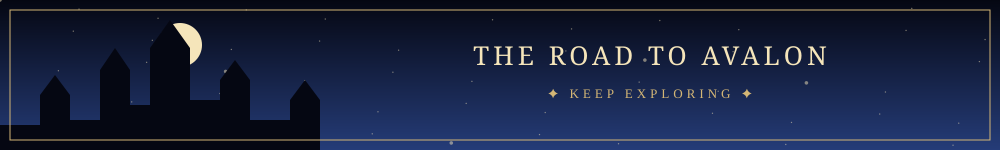

<div align="center">


### ✦ Exploring the universe, one line of code at a time ✦

**Software Development Student · Web Development · Space Enthusiast**

</div>


## ☄️ About Me

```python
developer = {
    "username": "AstharoXs",
    "role": "Software Development Student",
    "interests": ["Programming", "Astronomy", "Cats"],
    "status": "Learning and building"
}
```

- 🌌 Fascinated by astronomy, cosmology and black holes.
- 💻 I enjoy building web applications and solving problems through code.
- 🐈 Cat enthusiast.
- ✨ Always curious and eager to learn.


## 🪐 My Tech Stack

*Technologies I've worked with in academic and personal projects.*

### 💻 Languages & Web Development


### 🚀 Frameworks & Tools


## 🚀 Featured Project

### 📦 Inventory & Personnel Management System

An ongoing software project designed to support inventory control, employee assignments, attendance tracking and administrative notifications.

**Status:** In development

<!-- Add the project repository link when it becomes public. -->


## ✨ GitHub Activity

<div align="center">


<br/>


</div>


## 🌠 Connect With Me

<div align="center">

[](https://github.com/AstharoXs)

*The universe is vast, and there's always something new to discover.*

⭐ Thanks for visiting my little corner of the universe!

</div>


